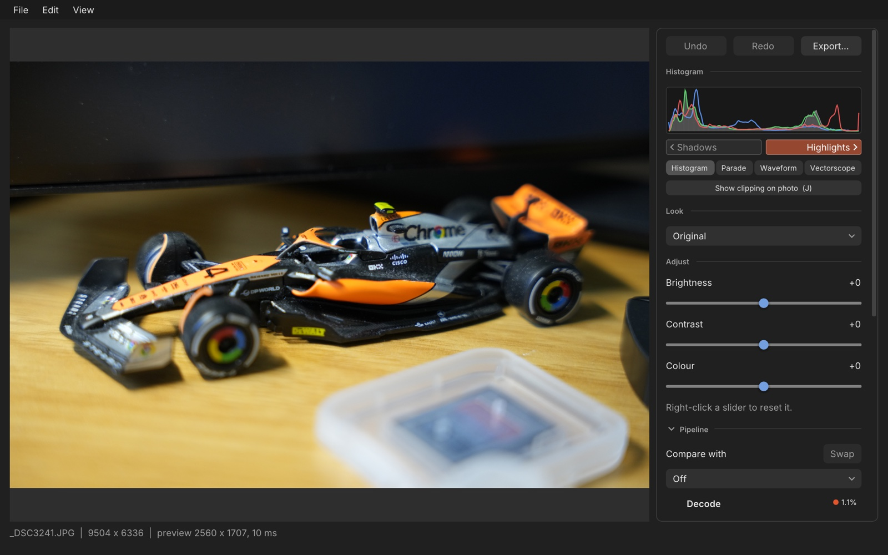

# Prism user guide

Prism is a photo editor for PNG, JPEG and camera RAW files. It shows what each step of an edit does to the light, so you can see why a photo looks the way it does. This guide covers the desktop app. The command-line tool is in [CLI.md](CLI.md).

Contents: [First launch](#first-launch) · [A walkthrough](#a-walkthrough) · [Recipes](#recipes) · [Keyboard shortcuts](#keyboard-shortcuts) · [How Prism thinks about light](#how-prism-thinks-about-light) · [Preferences](#preferences) · [Reference details](#reference-details)

## First launch

Download the zip for your system from the [Releases](https://github.com/Peaperfish/prism/releases) page:

| Download | For |
|---|---|
| `prism-<version>-macos-universal.zip` | macOS 13.3 or later, Apple Silicon and Intel |
| `prism-<version>-windows-x64.zip` | Windows 10 and 11, 64-bit |

Each zip holds the app (`Prism.app` on macOS, `prism_gui.exe` on Windows), the command-line tool (`prism`, `prism.exe`), Prism's `LICENSE.md`, `THIRD_PARTY_NOTICES.txt`, LibRaw's and Inter's licence files in `licenses/LibRaw/` and `licenses/Inter/`, and a short `README.txt`. Both include RAW support. Nothing needs installing beside them.

Each release also has `LibRaw-<version>-source.tar.gz`, the LibRaw source the builds were made from, and `SHA256SUMS.txt`, the checksums of the downloads.

### The unsigned-app warning

Prism isn't signed by Apple or Microsoft yet, so both systems warn you the first time you open it. The app is the same either way; the warning is about the missing signature.

**macOS.** Unzip, and drag `Prism.app` to Applications.

1. Right-click (or Control-click) `Prism.app` and choose **Open**, then **Open** again.
2. On macOS 15 and later that no longer works. Try to open Prism once, then go to **System Settings → Privacy & Security**, scroll down to the message about Prism and click **Open Anyway**.

After that it opens normally. Only downloaded files are checked: a build you made yourself opens straight away.

**Windows.** Extract the whole zip (don't run the app from inside the zip), then run `prism_gui.exe`.

1. If Microsoft Defender SmartScreen says "Windows protected your PC", click **More info → Run anyway**.
2. If Smart App Control (Windows 11) is on, it blocks unsigned apps and there is no way to allow just one. Prism won't run until Smart App Control is off.

## A walkthrough

This follows one photo from opening to export. The control panel is on the right of the window; the photo is on the left. Hover over any control: the **Explain area** at the foot of the panel says what it does to the light.

### Open a photo

- **File → Open…** (`Cmd+O` on macOS, `Ctrl+O` on Windows and Linux), or the **Open photo…** button on the empty window.
- **Drag and drop** a file onto the window, also when a photo is already open. Prism opens one photo at a time: if you drop several, it opens the first and says so.
- Or give the path when starting the app (`prism_gui photo.jpg`), or use "Open with" on Windows.

Prism opens PNG, JPEG and RAW files (`.arw`, `.dng`, `.cr2`, `.cr3`, `.nef`, `.raf`). The preview is shrunk to fit 2560 pixels on its longer side, so editing stays quick. For a RAW file the preview is also decoded at half size, and the status bar says "RAW, half-size preview". Export always starts again from the full-size file.

The status bar at the foot of the window shows the file name, the size of the decoded image, the size of the preview and how long the last preview took. If a file can't be opened, a message appears over the photo with a **Details** section and a **Copy** button; the photo you had open stays open.

### Simple sliders and Looks

At the top of the panel, **Look** is a menu of starting points:

- RAW files: Natural, Original, Vivid, Soft, Black & white.
- PNG and JPEG files: Original, Vivid, Soft, Black & white.

A look is not hidden. It sets four things you can see in the Pipeline view: Exposure, Saturation, Contrast and the Tone curve. Pick one and then change any of them, and the menu reads **Custom**. A RAW file opens with Natural (one stop brighter, with the filmic curve), because a RAW file is linear and looks dark and flat as it comes from the sensor. A PNG or JPEG opens with Original, which changes nothing. **Reset to** *name* goes back to that starting look.

While the menu names a look, a muted line under it says what the look does, for example "+1.00 stops, colour ×1.25, contrast ×1.15, filmic". It names only what changes the picture, so a PNG or JPEG look has no exposure or curve in it, and Original reads "no adjustments". **Custom** has no line.

**View recipe**, under that line, opens the look as the [recipe](#recipes) it is: the file built into Prism, as text you can select, with a **Copy** button. The window keeps showing the look you opened it for, even if you then change the settings, and it does not stop you editing the photo. A built-in look leaves the colour matrix and the RAW options alone, as the window says.

Under **Adjust** are three sliders, each from −100 to +100:

| Slider | What it does | At the ends |
|---|---|---|
| Brightness | Changes the light in stops. +50 is +1 stop, which doubles the light | −100 and +100 are −2 and +2 stops |
| Contrast | Pushes tones apart around middle grey | ×0.67 to ×1.5 |
| Colour | Makes colours stronger or weaker, without changing brightness | −100 is black and white, +100 doubles the colour |

Drag a slider and the photo follows. Right-click a slider to get **Reset to 0**. Ctrl-click (Cmd-click on a Mac) a slider to type a value. A whole drag is one undo step. If a value is beyond what the slider can show, the slider shows **(custom)** and sits at its end until you move it.

### The Pipeline view

Below the sliders, the **Pipeline** section lists the stages the light goes through, in order:

1. **Decode**: the file turned into linear light.
2. **Exposure**
3. **Colour matrix**
4. **Saturation**
5. **Contrast**
6. **Tone curve**
7. **Output encode**: light turned into the 8-bit sRGB file.

(The next section, [How Prism thinks about light](#how-prism-thinks-about-light), explains why the order matters.)

- **Click a stage** to see the photo as it looks right after that stage. A badge over the photo says **Viewing: after** *stage* and has a **Final image (Esc)** button. The histogram and scopes show that stage too. Pressing `Esc` or clicking Output encode brings back the final picture.
- **Switch a stage off** with its checkbox (the five middle stages have one). The row reads "(off)" and the photo shows what it looks like without that stage. The stage keeps its value, so switching it on again brings it back. Each switch is one undo step.
- **Per-stage controls** sit under the stage's name:
  - Exposure, Saturation and Contrast have a slider that is the same slider as Brightness, Colour and Contrast above (moving one moves the other), with the value in its own units: `+0.70 stops` (−2 to +2), `×1.20` for Saturation (`×0.00` to `×2.00`; exactly 0 reads "black and white") and `×1.20` for Contrast (`×0.67` to `×1.50`).
  - Tone curve has a menu (None, Gamma, Reinhard, Filmic). Gamma has a slider for the exponent (0.5 to 4, default 2.2). Reinhard has a slider for its white point (1 to 16, default 4). Filmic has no setting. Right-click for **Reset to**.
  - Colour matrix shows the name of the matrix file, or `none`. The app gets a matrix only from a [recipe](#recipes): one that names the file its numbers came from shows that name, and one that names none reads `recipe matrix`.
  - Decode and Output encode have nothing to edit.
- A stage that is switched off shows its controls greyed out, with the value it will have when it is switched on.
- If you edit a stage that comes after the one you are viewing, the photo can't change, and the row says **Not visible here** and names the stage you are viewing.
- Hover over a stage name for a one-sentence explanation.

### Compare two stages

At the top of the Pipeline section, **Compare with** shows a second point in the pipeline next to the one you are viewing. Choose **Original** (the file as decoded, before any edit) or any stage. The photo splits in two at the same size and position, so the halves line up:

- the compared stage is on the **left**, the viewed stage on the **right**, each with a label in its corner;
- **drag the divider** to move it (it stays between 5% and 95% of the width of the picture on the canvas, so zoomed in it stays in reach and the picture moves under it);
- **Swap** exchanges the halves;
- **Off** (or choosing the viewed stage again) goes back to one picture;
- `Esc` clears the comparison first, then the viewed stage.

The histogram, scopes, clipping numbers and the `J` marks describe the viewed stage only, which is the right half (the marks are drawn over the right half). A comparison is only a view: it is not saved, it can't be undone, it goes back to Off when you open another photo, and it does not affect export.

### Zoom and pan

The photo opens fitted to the window. To look closer:

| To | On a trackpad | With a mouse | Keys |
|---|---|---|---|
| Zoom in or out, about the cursor | pinch (or `Cmd` and scroll) | the wheel | |
| Zoom in or out, about the middle | | | `=` or `+`, and `-` |
| Move the picture | scroll with two fingers | drag it, or hold `Space` and drag | |
| Fit the whole photo | | double-click at 100% | `F` |
| Go to 100% of the preview | | double-click | `1` |

On Windows and Linux the zoom key is `Ctrl`. Windows has no pinch of its own here: use `Ctrl` and the wheel.

A chip in the corner of the canvas shows the zoom, with **Fit** and **100%** buttons. You can go from fit up to 800%. Past 200% the picture stops smoothing, so you see its pixels as squares. Zooming and moving never re-render the photo, so they stay smooth however heavy your edits are.

**100% is 100% of the preview, not of the file.** The preview is at most 2560 pixels on its longer side. So the chip says "100% of preview", and one preview pixel sits on one pixel of your screen. Point at the chip and the Explain area tells you how this photo compares, for example "Preview 2560 px, file 9564 px on the long side: each preview pixel stands for about 3.7 file pixels across". The preview can't show you the file's finest detail, such as critical focus; an export always uses every pixel. If the file is no bigger than the preview, the chip just says "100%".

Dragging follows a few rules:

- A plain drag moves the picture only when you are zoomed in. It starts after a small movement, so a click stays a click.
- The comparison's divider wins over a plain drag: press on it and you move the divider. Hold `Space` and drag to move the picture from anywhere.
- `Space` belongs to the picture only while the cursor is over it and you aren't typing or using a control. Elsewhere it still presses the focused button.
- Double-clicking does nothing on the test strip or the divider.

Zoom is only a view: it is not saved, it can't be undone, it goes back to fit when you open another photo, `Esc` leaves it alone, and it does not affect export.

### The test strip

A darkroom test strip prints one frame in bands at different exposures, so you can pick by eye. Prism does the same on the screen: press `T`, click **Test strip** (next to Brightness, or in the Exposure row), or use **View → Test Strip**.

- The photo is cut into five bands along its longer side (side by side for a landscape photo, stacked for a portrait), darkest first.
- A bar above the photo picks the step between bands: **⅓**, **½** (the default) or **1 stop**. It also says what that step means, for example "A full stop doubles the light; each half stop is about 1.4×." Its **×** button closes the strip.
- Each band has a label with its offset from your current exposure and the change in light: **−1 stop · ½× light**, **−½ · 0.71×**, **0 · now**, **+½ · 1.41×**, **+1 · 2×**. The middle band is your photo as it is now.
- The band under the cursor is outlined, and the histogram and scopes show that band (the middle one when the cursor is elsewhere). The histogram's title says which, for example *Histogram (−½ stop band)*.
- While the strip is on, the Pipeline list hides its clipping dots and says so.
- Press `J` to mark clipping in each band, to see which exposure starts to blow the highlights.
- **Click a band** to use its exposure. This is one undo step; the strip stays on, centred on the new exposure. Clicking the middle band does nothing.

The strip works zoomed in too: each band on the canvas keeps its label. A plain drag doesn't move the picture while the strip is on, because a click there sets the exposure; hold `Space` and drag instead.

The strip needs the Exposure stage or a later one in view: while you are viewing Decode no edit shows, so the strip is greyed out, and a tooltip says why. Turning the strip on clears a comparison. `Esc`, the **×** button or `T` again turn it off. The strip is only a view: it is not saved, it can't be undone, it goes away when you open another photo, and **export is never affected**.

### Clipping

*Clipping* means a value has hit the top or bottom of what the file can hold. Prism tells you where, and whether the detail is gone or can still come back.

- **In the Pipeline view**, each stage row shows a dot and a percentage when something is out of range: orange for **highlights** (brighter than white), blue for **shadows** (no light left), and violet for colours **too saturated for sRGB**. A **filled** dot means the stage cut those pixels off and the detail is gone. A **hollow** dot means they are out of range but a later stage may still bring them back. The percentages are hidden at 0.
- **A line under the list** says where clipping starts and where it costs detail, for example "Highlights first clip at Exposure (2.1% of pixels); still recoverable until Output encode." or "Nothing clips." A second sentence appears only when there is something to say about colours too saturated for sRGB, for example "4.1% of colours are too saturated for sRGB after Colour matrix; Saturation clips them, so hues may shift."
- **On the photo**: the **Show clipping on photo (J)** button under the histogram, or the `J` key, marks those pixels on the preview for the stage you are viewing: orange-red for brighter than white, blue for no light left, violet diagonal stripes (about 4 preview pixels wide, so the colour underneath stays visible, and wider on screen as you zoom in) for too saturated for sRGB. A pixel that an earlier stage already cut off stays marked in later stages. It is off by default and Prism remembers the setting.
- **The status-bar note.** Once a photo is open, the right end of the status bar says in a few words what clipped, with the same dot colours: "2.7% clipped in the file", "3% highlights clipped at Output encode" or "No clipping". Hover over it for the full sentence. It follows your edits and settles a moment after you stop dragging.
- **The histogram's two indicators**, **Shadows** and **Highlights**, light up when any channel is below black or above white. Hover for the percentage in red, green and blue.

The histogram can be switched to a **Parade** (red, green and blue levels side by side from left to right across the photo), a **Waveform** (the brightness of each part of the photo, with guide lines at 0, 25, 50, 75 and 100%) or a **Vectorscope** (which colours are present and how strong; the centre is neutral grey, and a line marks where skin tones usually sit). Prism remembers your choice.

### The Explain area

At the foot of the panel, a box says in plain words what the control under the mouse does to the light. It has a one-line summary, a short detail, and a live line worked out for the current value. For example, Brightness at +35 reads "+35: +0.70 stops, 1.62× the light". It follows the control you hover over, else the focused one, else the last one you changed. It is at most about five lines tall and scrolls when a text is longer. Tooltips show just the summary, after the same short delay everywhere. You can switch the Explain area off in [Preferences](#preferences); tooltips stay.

### Undo and redo

**Undo** and **Redo** buttons sit at the top of the panel, and **Edit → Undo** and **Redo** do the same. Every change to a slider, a stage switch, a look or the tone curve is a step, and so is loading a recipe; Prism keeps up to 100. A whole slider drag is one step. Test strip, comparison and the stage you are viewing are views and are not part of undo.

### Export

**Export…** at the top of the panel, or **File → Export…** (`Cmd+E` or `Ctrl+E`), saves the photo with your edits as a PNG or JPEG.

- The file name is suggested as the photo's name plus `_prism` next to the original (`IMG_0001.jpg` becomes `IMG_0001_prism.jpg`). A PNG source suggests PNG; anything else, including RAW, suggests JPEG.
- If you type a name without `.png`, `.jpg` or `.jpeg`, the extension is added.
- Prism won't overwrite the photo you opened: choose another name.
- Export decodes the file again at **full size** and runs every stage, so it does not depend on the preview. A **Saving…** window shows while it runs, with a **Cancel** button.
- The result is 8-bit sRGB. JPEGs are saved at quality 95.

### Recipes

A **recipe** is a small text file, ending in `.prism`, that writes down an edit: the exposure, the colour matrix, the saturation, the contrast and the tone curve, each with its on/off switch. It holds numbers, not pixels, so you can use it on any photo, read it in a text editor and send it to someone. [RECIPES.md](RECIPES.md) describes the format line by line.

**Saving.** **File → Save Recipe…** (`Cmd+Shift+S` or `Ctrl+Shift+S`), or **Save recipe…** in the Look section of the panel, first asks for two things:

- **Name**, filled in for you: the recipe you loaded (with "(modified)" once you have changed something), or the look you picked, or empty with the hint "Name this look". The suggested file name is made from it.
- **Description** (optional): one line on what the recipe is for, filled in from the recipe you loaded or the look you picked. If you keep both for a built-in look, the file you save is that look's file plus a `[matrix]` section.

The sheet says what is saved: all five stages. The photo and the RAW decoding options (half size, camera matrix) are not in a recipe. `Esc` cancels; while you are typing in a field, the first `Esc` only leaves the field. **Save…** then opens the system's save dialog. It starts in the folder you last saved or loaded a recipe in (Prism remembers it in your [preferences](#preferences)), or next to the photo the first time. If you type a name without `.prism`, it is added. A banner says "Saved recipe *name*.prism." when it is written.

**Loading.** **File → Load Recipe…** (`Cmd+Shift+O` or `Ctrl+Shift+O`), or **Load recipe…** in the panel, applies a recipe to the open photo:

- It sets each stage the recipe has, with its switch, and leaves the others as they are. It is one undo step, and the photo is not decoded again.
- Under the Look menu, **Recipe:** *name* says which recipe it was (point at it for its description), with a line saying what it set: "Sets all five stages." or, for a recipe with only some of them, "Sets only Colour matrix, Saturation and Contrast; the other stages are unchanged." A recipe that switches a stage off says so too.
- Change anything and the line reads *name* **(modified)**; undo back past the load and it goes away, and Redo brings it back. Opening another photo clears it.
- The Look menu stays honest: it names a built-in look only when the numbers match one, and otherwise reads **Custom**, whatever the recipe is called.
- A colour matrix from a recipe shows in the Pipeline view under the file name the recipe gives, or as `recipe matrix` when it gives none.

**Dropping.** Drop a `.prism` file on an open photo to apply it, just like Load Recipe…. Prism applies one recipe at a time. A recipe dropped together with a photo isn't applied (the photo opens, and a note asks you to drop the recipe again once it is open), and with no photo open Prism asks you to open one first.

**When a recipe has a mistake**, nothing changes and a **Recipe not loaded** window lists every mistake with its line, for example "line 5: unknown setting 'amout' in [saturation]. Did you mean 'amount'?" (Prism stops at 10). **Copy** puts the list on the clipboard; **Close** or `Esc` closes the window. A missing or unreadable file is reported the same way.

### Unexported edits

If you quit (`Cmd+Q` on macOS, `Ctrl+Q` on Windows and Linux, the close button or **File → Quit**) or open or drop another photo while your settings differ from the last export and from the last recipe you saved (or, if you have saved neither, from when you opened the photo), Prism asks: "You have edits that haven't been exported or saved as a recipe." Under it, a line says what you saved last, for example "Last saved: exported as IMG_0001_prism.jpg" or "Last saved: recipe Warm grade.prism". The buttons:

- **Export…** goes on with the quit or open only after the export succeeds.
- **Save Recipe…** shows the save sheet and then the save dialog; the quit or open goes on once the recipe is written. Cancelling either, or a recipe that can't be written, cancels the quit or open.
- **Quit Without Saving** (or **Open Without Saving**).
- **Cancel** (also `Esc`).

On macOS **Quit Without Saving** stands on its own on the left, and Cancel, Save Recipe… and Export… are on the right; on Windows and Linux the order is Export…, Save Recipe…, Quit Without Saving, Cancel. Export… is the default (`Enter`) on both.

Undoing back to an exported or saved state counts as having no edits. If an export is still running, Prism waits for it first. A quit while the recipe save sheet is open closes the sheet before asking.

## Keyboard shortcuts

On macOS the main key is `Cmd`; on Windows and Linux it is `Ctrl`. This is every shortcut in the app.

| Action | macOS | Windows / Linux |
|---|---|---|
| Open a photo | `Cmd+O` | `Ctrl+O` |
| Export | `Cmd+E` or `Cmd+S` | `Ctrl+E` or `Ctrl+S` |
| Load a recipe | `Cmd+Shift+O` | `Ctrl+Shift+O` |
| Save a recipe | `Cmd+Shift+S` | `Ctrl+Shift+S` |
| Undo | `Cmd+Z` | `Ctrl+Z` |
| Redo | `Cmd+Shift+Z` or `Cmd+Y` | `Ctrl+Shift+Z` or `Ctrl+Y` |
| Preferences | `Cmd+,` | `Ctrl+,` |
| Bigger interface | `Cmd+=` or `Cmd++` | `Ctrl+=` or `Ctrl++` |
| Smaller interface | `Cmd+-` | `Ctrl+-` |
| Interface size back to Auto | `Cmd+0` | `Ctrl+0` |
| Mark clipping on the photo | `J` | `J` |
| Test strip on or off | `T` | `T` |
| Zoom in | `=` or `+` | `=` or `+` |
| Zoom out | `-` | `-` |
| Zoom to fit | `F` | `F` |
| Zoom to 100% of the preview | `1` | `1` |
| Move the picture while held, with a drag | `Space` | `Space` |
| Step back: close the Preferences, About, notices, Recipe not loaded or View recipe window if it has the focus; otherwise the test strip, then the comparison, then the viewed stage | `Esc` | `Esc` |
| Quit | `Cmd+Q` | `Ctrl+Q` |

Notes:

- The keypad's `+`, `-` and `0` also work with `Cmd`/`Ctrl` for the interface size, and its `+` and `-` alone for the zoom.
- Undo, Redo, `J`, `T` and the zoom keys do nothing while you are dragging a slider.
- `J`, `T`, the zoom keys and `Space` give way to a text field that has the keyboard, so typing a value never triggers them.
- `Esc` is also Cancel in the "unsaved edits" window, in the recipe save sheet (inside a text field, the first `Esc` only leaves the field), and in the "Saving…" window while a quit or open is waiting for the export.
- In the menus: **File** has Open…, Export…, Load Recipe…, Save Recipe… and Quit (on Windows and Linux the menu shows `Ctrl+Q`; on macOS, Quit is in the **Prism** menu too). **Edit** has Undo, Redo and (on Windows and Linux) Preferences…. **View** has Bigger Interface, Smaller Interface, Interface Size: Auto, Test Strip, Zoom In, Zoom Out, Zoom to Fit and 100% of Preview. **Help → About Prism** is on Windows and Linux; on macOS, About and Preferences are in the **Prism** menu (**Prism → About Prism**, **Prism → Preferences…**).

Mouse and trackpad: click a stage row to view it; right-click a slider, or the Tone curve menu, to reset it; Ctrl-click (Cmd-click) a slider to type a value; drag the divider in a comparison; click a band in the test strip; drag the panel's left edge to resize the panel; pinch, scroll or use the wheel over the photo to zoom and move it, drag it when zoomed in, and double-click it to go between fit and 100% (see [Zoom and pan](#zoom-and-pan)).

## How Prism thinks about light

### Stops

A **stop** is a doubling or halving of the light. One stop more is twice the light, two stops is four times, minus one stop is half. It is the same unit as the aperture ring and the shutter speed dial. In Prism, Brightness and Exposure are in stops: +1 stop doubles every pixel, and each half stop is about 1.4×. That is why +50 on the Brightness slider is +1 stop, and Brightness +35 reads "+0.70 stops, 1.62× the light". Middle grey, the reflectance of a standard grey card, is 18% in linear light. Contrast works in stops around it.

### Linear light

The numbers in a JPEG are not proportional to light. They sit on a curve (sRGB) that gives more of the numbers to the shadows. Prism undoes that curve first, in the **Decode** stage. After that, the numbers are proportional to light: twice the number is twice the light. In this form, +1 stop is exactly a multiplication by 2. A RAW file is already linear, which is why it looks dark and flat before a tone curve.

Prism works in linear light, with floating-point numbers, through every stage. Only the last stage, **Output encode**, turns the light back into the curved 8-bit sRGB numbers of the file and the screen.

### The order of the stages

The stages always run in this order, whatever order you change them in:

**Decode → Exposure → Colour matrix → Saturation → Contrast → Tone curve → Output encode**

The order matters because the stages are not interchangeable:

- **Exposure comes first** after Decode, while the numbers are still light. A stop of exposure then means exactly twice the light, and the stages after it can shape what that extra light looks like.
- **The Colour matrix** mixes red, green and blue in linear light, before saturation and tone. It is for calibrating camera colour or applying a grade.
- **Saturation** moves each colour away from, or towards, the grey of the same brightness. A colour that would go below zero stops at the most saturated version sRGB can show, so hues do not shift.
- **Contrast** is an S-curve around middle grey, in stops. It is strongest within about 2 stops of grey, so the extremes are not crushed.
- **The Tone curve** comes last, because it squeezes scene light to fit the screen. Linear light has more range than a screen shows. The curve compresses it: bright values are pulled in, so highlights have room. If you brightened after the curve instead of before it, you would only be making the compressed picture brighter and pushing highlights past white.
- **Output encode** is last. Anything still above white or below black is cut off here, and cannot come back.

Switching a stage off in the Pipeline view shows you what it contributed.

### What clipping means

A file can only hold values from black to white. In linear light, black is 0 and white is 1. Clipping is when a value falls outside that and is cut off at 0 or 1: **highlights** that were brighter than white, **shadows** that have no light left, and colours **too saturated for sRGB**, where a channel would need negative light (a strongly saturated yellow or orange, pushed further by a colour matrix, can end up with a negative blue; the encode cuts it to 0 and the colour's hue shifts).

A value outside the range is not lost by itself. Prism keeps it as a number, so a later stage may bring it back: darkening with a tone curve can pull a highlight back under white. Detail is lost only where a stage cuts values off at white or black. Until then the values are kept. In the Pipeline view that is the difference between a hollow dot (recoverable) and a filled dot (lost). Saturation and Tone curve cut off values below 0, and Output encode cuts off both ends; Exposure, Colour matrix and Contrast never do. The Decode stage counts pixels that were already at white in the file (a RAW file's saturated sensor values, or 255 in an 8-bit file) as lost before any edit.

## Preferences

Open **Preferences** from the Edit menu (Windows and Linux) or the Prism menu (macOS), or press `Cmd+,` / `Ctrl+,`. It is an ordinary window; changes apply at once and you can keep editing.

- **Appearance:** System (the default: follows the operating system's light or dark mode, also when it changes while Prism is open), Light or Dark. In every theme the canvas behind the photo stays a neutral grey (slightly lighter in Light), never white, black or tinted, so it does not change how bright or colourful the photo looks.
- **Interface size:** Auto (the display's scale, for example 150% on a Windows laptop set to 150%) or 75% to 200% in steps of 25. `Cmd`/`Ctrl` with `+`, `-` and `0` change it too, also from the View menu.
- **Panel width:** the width of the control panel. You can also drag the panel's left edge. The panel never takes more than 40% of the window (or less than 240 points where there is room). **Reset layout** goes back to 320 points.
- **Show explanations** (on by default): the Explain area. Tooltips keep their one-line summary either way.
- **Restore defaults** resets all of the above, and also the scope you chose and the clipping marks.

**Help → About Prism** (on macOS, **Prism → About Prism**) shows the version, Prism's licence and the third-party components with their licences; **Third-party notices…** opens their full notices. `Esc` closes it.

Prism keeps the preferences in a file, `preferences.txt`, in the folder the system gives the app for its data: `~/Library/Application Support/Prism/Prism/` on macOS, `%APPDATA%\Prism\Prism\` on Windows, `~/.local/share/Prism/Prism/` on Linux. It holds `key=value` lines and is safe to edit or delete: a missing or damaged file, or a bad value, falls back to the default for that setting alone, and settings this version doesn't know (from a newer one) are kept. The file is written atomically (a temporary file renamed over it), so a crash doesn't leave half a file. The window layout is kept next to it in `imgui.ini`.

## Reference details

The exact numbers behind what the app shows.

- **Histogram.** Rec. 709 luminance as a filled area, with red, green and blue lines on top, 256 bins each, on the display scale: a value falls in the bin of its sRGB code, so linear middle grey 0.18 sits near bin 118 and the shadows are not squashed. It is measured on the stage's values *before* the 8-bit encode, so it can count what clips separately from the end bins.
- **Scopes.** A scope measures the stage you are viewing, on the display scale (the 8-bit sRGB values on screen). The vectorscope has a round graticule with targets for R, Mg, B, Cy, G and Yl at 75% saturation, and the skin-tone line at about 123°. The counts are drawn log-scaled, so faint detail stays visible.
- **Clipping counts.** They come from a sample of at most 250,000 pixels of the preview. Decode counts any channel within 0.000001 of 1.0, so a value exactly at white in the file counts too. A negative channel on a pixel that still has light is not a shadow: it is a colour outside sRGB.
- **Outside the sRGB gamut.** A pixel counts as too saturated for sRGB when it still has light (luminance above 0) but a channel is below −0.00015 in linear sRGB (half an 8-bit step at the dark end of the sRGB curve; smaller negatives round to 0 anyway). A pixel with no light is a shadow, not a gamut problem. "Pushed out" names the first stage with such colours (usually Colour matrix); "clips" names the first later stage that cuts negatives: Saturation if it runs, otherwise Tone curve, otherwise Output encode. Saturation limits its own result to the edge of the gamut rather than cutting it off, so that is not counted as a loss; only colours that arrive at Saturation already negative are.
- **Marks on the photo.** Where a pixel is in several categories, highlights win over gamut, and gamut over shadows.
- **Test strip labels.** The offsets are exact (a third of a stop is 1/3, not 0.33). A third of a stop is about 1.3× the light, half a stop about 1.4×, a whole stop 2×.
- **Looks.** Each look's numbers are in its recipe file. RAW: [Natural](../recipes/raw/natural.prism), [Original](../recipes/raw/original.prism), [Vivid](../recipes/raw/vivid.prism), [Soft](../recipes/raw/soft.prism), [Black & white](../recipes/raw/bw.prism). PNG and JPEG: [Original](../recipes/image/original.prism), [Vivid](../recipes/image/vivid.prism), [Soft](../recipes/image/soft.prism), [Black & white](../recipes/image/bw.prism). [Why each look is what it is](../recipes/README.md).
